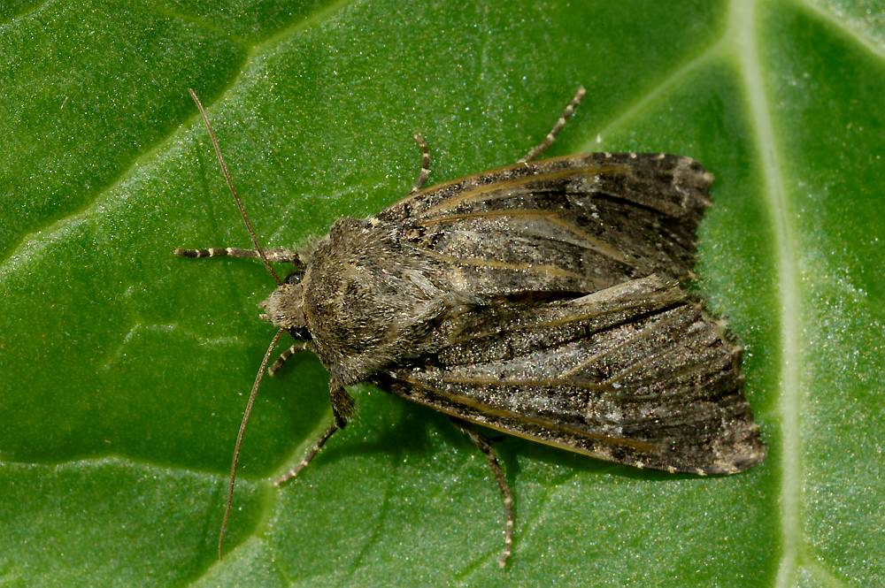
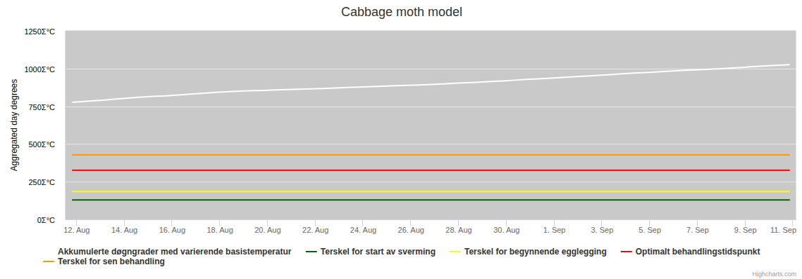

# MamestraBrassicaeModel

The model for the warning system for cabbage moth was developed by Dr. Nina Svae Johansen. It is based on the minimum temperature threshold and the requirement for accumulated day-degrees for the different stages of the cabbage moth [CITATION Joh96 \t \l 1044 ]. The accumulated degree-day model calculates forecasts for development of the cabbage moth through the summer, generates warnings for the time when eggs and small larvae can be registered in the field and the best time for treatment [CITATION Joh97 \t \l 1044 ].

<table>
<tbody>
<tr>
<td>
<p><strong>Developmental period</strong></p>
</td>
<td>
<p><strong>Base temperature</strong></p>
</td>
<td>
<p><strong>Day-degree requirement</strong></p>
</td>
<td>
<p><strong>Accumulated day-degrees <br /> (with different base temperatures)</strong></p>
</td>
<td>
<p><strong>Warning status </strong></p>
</td>
</tr>
<tr>
<td>
<p>1. Development of overwintered pupae until adult flight period</p>
</td>
<td>
<p>Pupae: 7,5 &deg;C (TMJ10)</p>
</td>
<td>
<p>129</p>
</td>
<td>
<p>129</p>
</td>
<td bgcolor="#70ad47">
<p>SUMDG &lt; 158</p>
</td>
</tr>
<tr>
<td>
<p>2. Start of flight period until oviposition</p>
</td>
<td>
<p>Oviposition: 5,0 &deg;C (TM)</p>
</td>
<td>
<p>56</p>
</td>
<td>
<p>129+56=158</p>
</td>
<td bgcolor="#ffc000">
<p>SUMDG &ge;158&lt;326</p>
</td>
</tr>
<tr>
<td>
<p>3. Start of oviposition until the first larvae in stage L2</p>
</td>
<td>
<p>Eggs: 8,6 &deg;C (TM)</p>
<p>L1: 7,7 &deg;C (TM)</p>
</td>
<td>
<p>Eggs: 75</p>
<p>L1: 66</p>
</td>
<td>
<p>129+56+75+66=326</p>
</td>
<td bgcolor="#ff0000">
<p>SUMDG &ge;326&lt;428</p>
</td>
</tr>
<tr>
<td>
<p>4. From the first larvae in stage L2 until the first larvae in stage L4</p>
</td>
<td>
<p>L2: 6,9 &deg;C (TM)</p>
<p>L3: 6,3 &deg;C (TM)</p>
</td>
<td>
<p>L2: 49</p>
<p>L3: 53</p>
</td>
<td>
<p>129+56+75+66+49+53=428</p>
</td>
<td bgcolor="#ffc000">
<p>SUMDG &ge;428&lt;557</p>
</td>
</tr>
<tr>
<td>
<p>5. From the first larvae in stage L4 until the first larvae in stage L6</p>
</td>
<td>
<p>L4: 4,3 &deg;C (TM)</p>
<p>L5: 6,0 &deg;C (TM)</p>
</td>
<td>
<p>L4: 67</p>
<p>L5: 62</p>
</td>
<td>
<p>129+56+75+66+49+53+67+62=557</p>
</td>
<td bgcolor="#d0cece">
<p>SUMDG &ge;557</p>
</td>
</tr>
</tbody>
</table>

*Table 1: Developmental stages of the cabbage moth, base temperature requirement and day-degrees for development*

Historical weather data and weather forecasts are used in the model (2-day forecasts, i.e. forecasts for the same day and the next day).

The input measurements for the model are hourly standard air temperature (TM) and soil temperature at a depth of 10 cm (TMJ 10). The calculated values that are input in the model are daily mean, daily accumulated temperature and total accumulated temperature.

## Interpretation of the warning

Note that the model is based on temperature, it is not related to the presence or absence of cabbage moth in the field. Thus, it is important to evaluate the situation in the field.

Green rectangles indicate that there is no danger of attack. Green rectangles are shown prior to the start of oviposition (SUMDG < 158).

Yellow rectangles (prior to red rectangles) indicate that oviposition has begun and that the farmer should make observations in the field. Yellow rectangles are first shown when the soil temperature has reached 158 day-degrees (SUMDG=158). Yellow rectangles are also shown later in the season, after a red warning, to indicate that it is beyond the optimal time for treatment (the small larval instars). The larvae are too big for effective chemical control (they seek shelter from the sun inside the heads).

Red rectangles indicate the optimal time for treatment (when when registration in the field indicates attack). At this time most of the larvae are small and easily targeted on the outer leaves.

Grey rectangles indicate that the warning has ended. The larvae are so big that chemical control is very difficult or no longer possible.


### Explanation of the graph

The graphic presentation shows the combined development of the accumulated day-degrees, with the different base temperatures related to the separate developmental stages, related to the threshold values for: start of flight period, start of oviposition, optimal time of treatment and late time of treatment (when there may still be some small larvae, but most are too big).



The graph shows straight horizontal lines for the threshold values for the start of the flight period, optimal time of treatment and late time of treatment. The background color on the graph indicates when the warning is green, yellow and red and when the warning has ended for the season (grey background color). When the line «Cumulative day-degrees with varying base temperatures» crosses one of the horisontal threshold lines, the warning changes.

The vertical dotted line indicates today’s date (given that you are looking at a chart where today is not outside the time line)

### Warning season – start and end of the warning
#### Starting time
The warning model is started May 1st using previously recorded temperatures.

#### Ending time
The warning model is finished (changes to grey) when the accumulated day-degrees = 557. At this point chemical control is no longer possible as the larvae are too big, they seek shelter from light and have chewed into the heads.

## Testing and validation of the model
### Nationally
The model was previously used by ”Planteforsk Plantevernets” telephone warning service (NORPRE) from 1993-1999. The model has been used in VIPS since VIPS began in 2001.

There have been attempts to validate the model in Norway, but when this was attempted there was no cabbage moth attack.

### Internationally
There is no information at present.

 

## References
Johansen, N. (1996). Prediction of field occurence of the cabbage moth, Mamestra brassicae (Lepidoptera: Noctuidae): Pheromon traps and day-degree. Norwegian Journal of Agricultural Sciences, 10: 541-554.

Johansen, N. (1997). Influence of temperature on development, fecundity and survival of the cabbage moth Mamestra brassicae (L.) (Lep., Noctuidae) in relation to the improvement of forecasting and control methods. Journal of Applied Entomology, 121: 81-88. doi:10.1111/j.1439-0418.1997.tb01375.x

Johansen, N.S. 1994. Varsling av kålfly (Mamestra brassicae L.). Gartneryrket 84, 20-21.

## Contacts
[Annette Folkedal Schjøll](https://nibio.no/en/employees/annette-folkedal-schjoll)

Links for more information
More information on cabbage moth (Mamestra brassicae) is available in the Plantevernleksikonet (Norwegian only): https://www.plantevernleksikonet.no/l/oppslag/49/

### Development

Clone Gitlab repository

```
$ git clone https://gitlab.nibio.no/VIPS/models/java/Model_MAMESTRABR.git
$ cd Model_MAMESTRABR
```

### Compile, run tests
```bash
mvn clean install
```

### Deploy to VIPSCore
See [the VIPSCore README](https://gitlab.nibio.no/VIPS/VIPSCore)